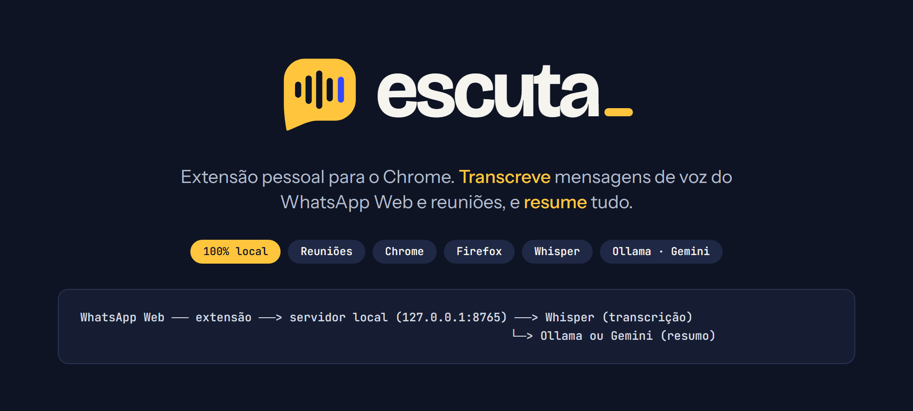
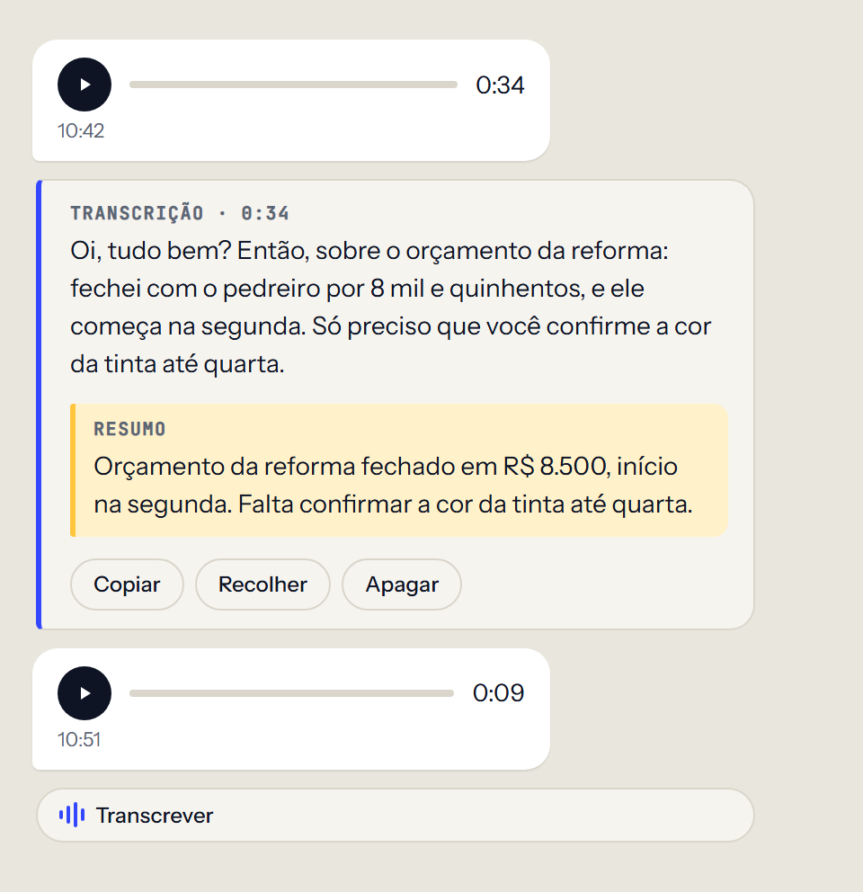
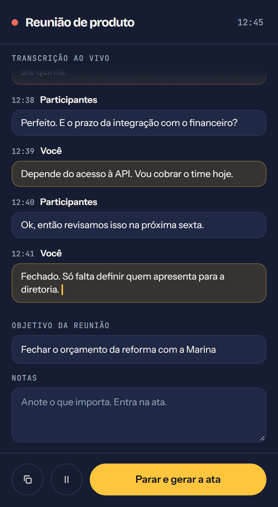
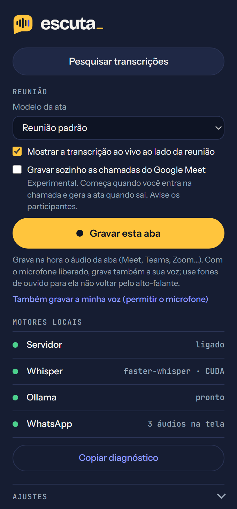
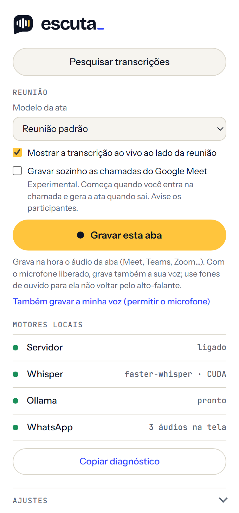
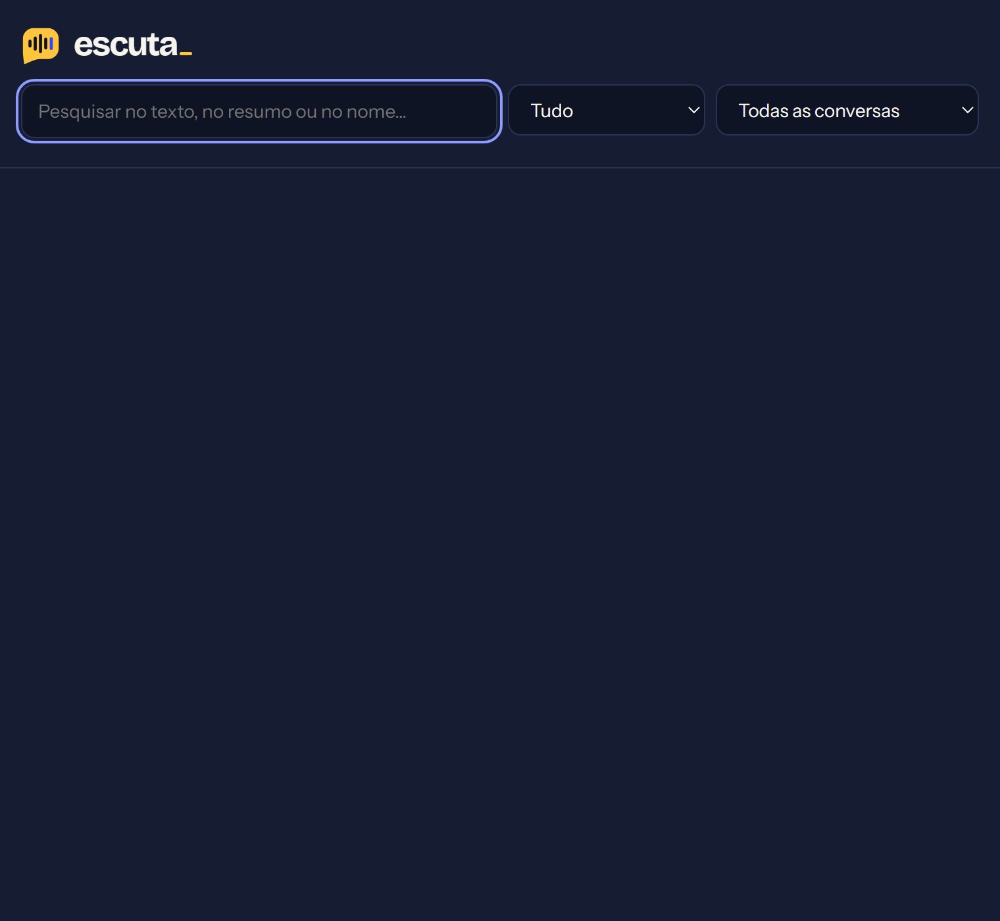
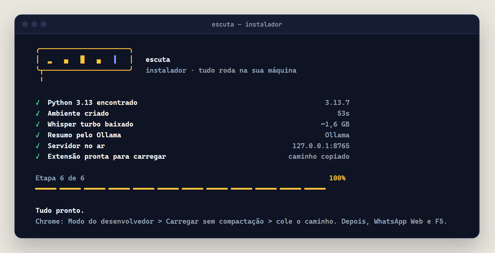
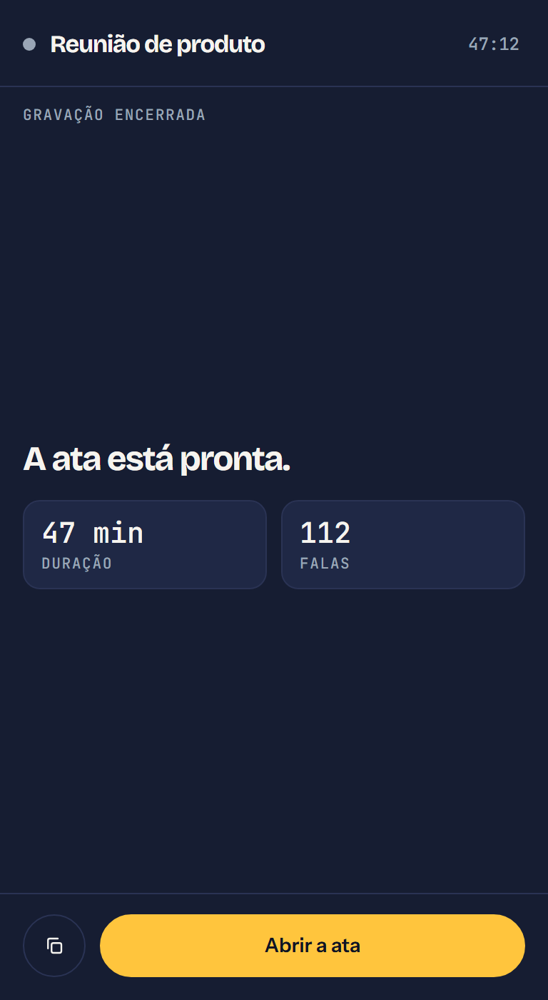

<p align="center">
  
</p>

<p align="center">
  <b>Transforme mensagens de voz e reuniões em texto, resumo e ata, sem mandar o áudio para a nuvem.</b>
</p>

<p align="center">
  
  
  
  
  
</p>

<p align="center">
  <a href="#o-que-é">O que é</a> ·
  <a href="#instalação-rápida">Instalar</a> ·
  <a href="#como-usar">Como usar</a> ·
  <a href="#reuniões">Reuniões</a> ·
  <a href="#configuração">Configuração</a> ·
  <a href="#problemas-comuns">Problemas comuns</a>
</p>

---

## O que é

O **Escuta** é uma extensão para o navegador, com um pequeno servidor que roda no seu próprio computador. Ele faz três coisas:

1. **Transcreve mensagens de voz do WhatsApp Web.** Cada áudio ganha um botão **Transcrever**.
2. **Grava e transcreve reuniões** (Google Meet, Teams, Zoom no navegador) e escreve a **ata** no final.
3. **Resume** tudo, para você ler em 20 segundos o que levaria 5 minutos para ouvir.

A transcrição acontece na sua máquina, com o [Whisper](https://github.com/SYSTRAN/faster-whisper). **O áudio nunca sai do seu computador.** Só o texto já transcrito vai para o Gemini, e só se você escolher usá-lo para os resumos (veja [Privacidade](#privacidade)).

## Veja como fica

<table>
  <tr>
    <td align="center" width="50%">
      <br>
      <sub><b>No WhatsApp Web:</b> botão Transcrever em cada áudio, depois o texto e o resumo.</sub>
    </td>
    <td align="center" width="50%">
      <br>
      <sub><b>Na reunião:</b> painel ao vivo com quem falou, notas e o botão de parar.</sub>
    </td>
  </tr>
  <tr>
    <td align="center">
      &nbsp;<br>
      <sub><b>O ícone da extensão:</b> gravar a aba, o estado dos motores e os ajustes. Tema claro e escuro.</sub>
    </td>
    <td align="center">
      <br>
      <sub><b>Tudo pesquisável:</b> mensagens de voz e atas de reunião num só lugar.</sub>
    </td>
  </tr>
</table>

## Como funciona

```
 WhatsApp Web  ─┐
                ├──>  extensão  ──>  servidor local  ──>  Whisper  (áudio vira texto)
 Aba da reunião ┘                    127.0.0.1:8765  └──>  Ollama ou Gemini  (texto vira resumo e ata)
```

- A **extensão** fica no navegador: coloca os botões no WhatsApp, grava a aba da reunião e mostra o resultado.
- O **servidor** é um programa Python que fica ligado em segundo plano. Só aceita conexões do seu próprio computador.
- O **Whisper** transforma o áudio em texto. Usa a placa NVIDIA quando existe e, sem ela, o processador.
- O **Ollama** (local) ou o **Gemini** (nuvem, opcional) escrevem os resumos e as atas.

## O que ele faz

| Recurso | Como é na prática |
| --- | --- |
| **Transcrição no WhatsApp** | Botão **Transcrever** em cada mensagem de voz. Em áudio longo, o texto aparece aos poucos. |
| **Resumo** | Botão **Resumir** depois da transcrição, ou automático para áudios com mais de 1 minuto. |
| **Reuniões com ata** | Grava a aba e o seu microfone, separa **Você** e **Participantes** e gera a ata a partir de um modelo. |
| **Painel ao vivo** | Transcrição aparecendo ao lado da reunião, com um bloco de notas que entra na ata. |
| **Pesquisa** | Página com tudo que já foi transcrito. A busca ignora acento e maiúscula. |
| **Tudo guardado no navegador** | Recarregar a página mostra o texto na hora, sem transcrever de novo. |

## Instalação rápida

Cole **uma linha** no terminal. Um assistente mostra cada etapa (Python, ambiente, modelo Whisper, resumo, servidor e extensão), pergunta antes de instalar e, no fim, copia o caminho da extensão e abre o `chrome://extensions`.

**Windows** (abra o PowerShell):

```powershell
irm https://raw.githubusercontent.com/Duuhhduuu/escuta/main/install.ps1 | iex
```

**Mac ou Linux** (abra o Terminal):

```bash
curl -fsSL https://raw.githubusercontent.com/Duuhhduuu/escuta/main/install.sh | bash
```

<p align="center">
  
</p>

O instalador coloca tudo em `~/escuta` (no Windows, `C:\Users\você\escuta`). Dá para mudar com a variável `ESCUTA_PASTA`. Pode rodar de novo quando quiser: ele atualiza os arquivos e não mexe no seu `.env`.

### Falta um passo: ligar a extensão no navegador

O Chrome não deixa nenhum programa instalar extensões sozinho, então esta parte é manual. Leva um minuto:

1. Abra `chrome://extensions` (no Brave, `brave://extensions`). O instalador já abre essa página para você.
2. Ligue o **Modo do desenvolvedor**, no canto superior direito.
3. Clique em **Carregar sem compactação**.
4. Escolha a pasta **`extension`** dentro da pasta do Escuta. O instalador copiou o caminho para a área de transferência: é só colar.
5. Abra o [WhatsApp Web](https://web.whatsapp.com) e aperte **F5**. Cada mensagem de voz passa a ter o botão **Transcrever**.

### O que você precisa

| | Mínimo | Observação |
| --- | --- | --- |
| **Sistema** | Windows 10 ou 11, macOS ou Linux | No Mac com chip Apple, a transcrição usa `mlx-whisper`. |
| **Navegador** | Chrome ou Brave | O Firefox funciona para o WhatsApp, mas não grava reuniões ([veja abaixo](#firefox)). |
| **Python** | 3.9 ou mais novo | No Windows, o instalador tenta instalar sozinho pelo `winget`. |
| **Disco** | Uns 5 GB livres | O modelo Whisper tem ~1,6 GB. Com placa NVIDIA, as bibliotecas CUDA somam mais ~700 MB. |
| **Placa de vídeo** | Opcional | Com NVIDIA a transcrição é muito mais rápida. Sem ela, funciona no processador. |
| **Para os resumos** | [Ollama](https://ollama.com/download) **ou** uma chave do Gemini | Um dos dois. Veja [Resumos](#resumos-gemini-ou-ollama). |

<details>
<summary><b>Prefere instalar sem o comando de uma linha?</b></summary>

<br>

**1. Baixe o projeto.** Sem git: em <https://github.com/Duuhhduuu/escuta>, clique no botão verde **Code** e depois em **Download ZIP**. Extraia e mova a pasta para um lugar fixo, como `C:\escuta`. Evite `Downloads` e a área de trabalho: o servidor roda dessa pasta toda vez que o computador liga, e mover a pasta depois quebra a inicialização automática. Com git:

```bash
git clone https://github.com/Duuhhduuu/escuta.git
```

**2. Instale o servidor.**

- **Windows:** instale o [Python 3](https://python.org) marcando **Add python.exe to PATH** e dê dois cliques em **`instalar.bat`**, na raiz da pasta. Ele instala o servidor, pergunta a chave do Gemini (pode pular), liga a inicialização automática e sobe o servidor.
- **Mac ou Linux:**
  ```bash
  cd server && ./setup.sh
  ```
  No Mac, instale o Ollama com `brew install --cask ollama` e baixe um modelo com `ollama pull qwen2.5:7b`.

**3. Ligue a extensão** pelos passos de [Falta um passo](#falta-um-passo-ligar-a-extensão-no-navegador).

Depois de atualizar os arquivos da extensão, clique em ⟳ no card dela em `chrome://extensions` e recarregue o WhatsApp Web (F5).

</details>

### Firefox

1. Abra `about:debugging#/runtime/this-firefox` e clique em **Carregar extensão temporária**. Escolha `extension/manifest.json`.
2. Abra `about:addons`, entre em **Escuta**, aba **Permissões**, e ative o acesso a `127.0.0.1`. O Firefox não concede isso sozinho.
3. A extensão temporária some quando o Firefox fecha. Para instalar de forma permanente é preciso assiná-la na Mozilla (distribuição própria, grátis) ou usar o Firefox Developer Edition.

## Como usar

### Mensagens de voz do WhatsApp

1. Deixe o servidor ligado. Se você aceitou a inicialização automática, ele já sobe sozinho com o computador. Se não, rode **`server\start.bat`** (Windows) ou `cd server && ./start.sh` (Mac e Linux) e deixe a janela aberta.
2. Abra o [WhatsApp Web](https://web.whatsapp.com). Cada mensagem de voz ganha um botão **Transcrever**.
3. Depois da transcrição, use **Resumir** ou **Copiar**. **Recolher** esconde o cartão e deixa só uma pílula, que reabre num clique. **Apagar** pede um segundo clique e remove a transcrição salva daquela mensagem.

As transcrições e os resumos ficam salvas **no navegador**. Recarregar a página ou voltar à conversa mostra o texto na hora.

### O ícone da extensão

Clique no ícone do Escuta para ver:

- **Pesquisar transcrições:** abre a página com tudo que já foi transcrito, do mais recente para o mais antigo. A busca procura no texto, no resumo, no nome da conversa e em quem mandou. Dá para filtrar por conversa, copiar e apagar.
- **Motores locais:** o estado do servidor, do Whisper (e qual motor está em uso) e do Ollama ou Gemini.
- **Ajustes:** idioma do áudio, modelo Whisper, modelo de resumo e duas opções automáticas:
  - *Transcrever sozinho o áudio mais recente recebido* (desligado por padrão). Como a extensão toca o áudio sem som para copiá-lo, ele fica marcado como ouvido no WhatsApp.
  - *Resumir sozinho áudios com mais de 1 min* (ligado por padrão).

## Reuniões

Além do WhatsApp, o Escuta grava reuniões online (Google Meet, Teams, Zoom no navegador…) e escreve a ata. Funciona no **Chrome e no Brave**.

### Gravar com um clique

1. Abra a aba da reunião e clique no ícone do Escuta **nessa aba**.
2. Em **Reunião**, escolha o **modelo da ata** e clique em **Gravar esta aba**. A gravação começa **na hora**, sem pedir nada.
3. Ao terminar, clique em **Parar e gerar a ata**.

O ícone mostra **REC** enquanto grava, **II** quando está pausado, **…** enquanto processa e **✓** quando a ata está pronta. Ela aparece em **Pesquisar transcrições**, com a ata formatada, a transcrição de quem falou o quê (**Você** e **Participantes**) e botões para copiar, baixar em `.md` e refazer a ata com outro modelo.

> [!NOTE]
> **O microfone é opcional.** Sem permissão, o Escuta grava o áudio da aba, que já tem todos os participantes. Para gravar também a **sua** voz, clique em *Também gravar a minha voz* no popup e permita o microfone, uma vez só.

> [!TIP]
> **Use fones de ouvido.** Sem fone, o microfone também capta o alto-falante e a conversa se repete. O servidor descarta o que for eco, mas com fone fica mais limpo.

### Gravar sozinho no Google Meet (experimental)

Marque **Gravar sozinho as chamadas do Google Meet** no popup. Daí em diante, quando você entra numa chamada o Escuta começa a gravar e abre o painel ao vivo, **sem nenhum clique**. Quando você sai, a gravação para e a ata é gerada.

- Funciona lendo o áudio que o próprio Meet usa, então **não pede permissão de microfone** e não depende de clicar no ícone.
- Vem **desligado** por padrão. Se ligar, **avise os participantes** de que a reunião está sendo gravada.
- Se o Meet já estava aberto quando você instalou ou atualizou, **recarregue a aba** uma vez.
- Gravou sem querer? Abra o popup e use **Descartar esta gravação**: o áudio é apagado e nenhuma ata é gerada.

### Pausar, retomar e desfazer

- **Pausar:** o botão ao lado de *Copiar*, no painel (ou **Pausar** no popup), segura a gravação e o texto ao vivo. O tempo parado não entra no arquivo e o som da reunião continua normal. Clique de novo para retomar.
- **Desfazer ao parar:** *Parar e gerar a ata* dá **8 segundos** para voltar atrás. O botão vira **Desfazer** com a contagem, e a gravação continua enquanto isso.

<p align="center">
  
</p>

### Como ele sabe quem falou

A extensão grava o áudio da aba e o seu microfone **em canais separados** do mesmo arquivo. O servidor transcreve cada canal sozinho e junta tudo por horário. Assim ele sabe o que foi você e o que foram os outros, sem tentar adivinhar vozes. Sem o microfone liberado, só a pista dos participantes é gravada.

### Painel ao vivo

Ao começar a gravar, um painel aparece ao lado da reunião, com a transcrição de 1 a 2 segundos depois de cada frase, quem falou e o horário. O áudio é cortado nas pausas da fala, então as frases saem inteiras. É uma prévia: a transcrição final, mais precisa, vem ao parar.

- No cabeçalho do painel: **minimizar** (vira uma bolinha com o símbolo do Escuta e um ponto vermelho piscando, que traz o painel de volta), **abrir em janela separada** e **fechar** (a gravação continua).
- **Notas:** a caixa embaixo é sua. Anote nomes, prazos e o que importa. Elas entram na ata: a IA as usa para acertar a grafia dos nomes e destacar o que você marcou.
- Se a página não aceitar o painel, ele abre numa janela ao lado e o popup mostra o motivo. **Mostrar a transcrição ao vivo** no popup liga e desliga o painel, e **Abrir a transcrição ao vivo** reabre se você o fechou.

### Bom saber

- A gravação é salva no disco do navegador a cada 10 s. Se o servidor estiver desligado ao parar, ou o navegador cair, o áudio não se perde: a reunião aparece com **Tentar de novo**.
- Fechar a aba da reunião encerra a gravação e gera a ata com o que foi gravado.
- Uma reunião de 1 hora tem uns 30 MB e leva alguns minutos para transcrever numa placa NVIDIA. Enquanto isso, mensagens de voz do WhatsApp esperam a vez.
- Se algo não aparecer, abra o popup: **O que aconteceu na última gravação** lista cada etapa (captura da aba, microfone, painel, servidor), com um botão para copiar.

### Modelos de ata

Reunião padrão, daily, projeto, retrospectiva, cliente e aula, na pasta `server/templates/`. Para criar o seu, copie um `.json` da pasta e mude o que quiser; vale na hora, sem reiniciar. Os cinco primeiros são adaptados do [Meetily](https://github.com/Zackriya-Solutions/meetily) (licença MIT); veja `server/templates/CREDITS.md`.

## Configuração

Quase tudo se ajusta pelo **ícone da extensão**. O resto fica no arquivo `server/.env` (copie `server/.env.example` para começar). Depois de mudar o `.env`, **reinicie o servidor**.

### Resumos: Gemini ou Ollama

Os resumos e as atas podem sair de dois lugares:

| | **Ollama** (padrão) | **Gemini** |
| --- | --- | --- |
| Onde roda | No seu computador | Na nuvem do Google |
| Privacidade | Nada sai da máquina | Só o **texto** já transcrito sai. O áudio nunca. |
| Custo | Grátis | Tem camada gratuita |
| Velocidade | Depende do seu computador | Rápido, em segundos |
| Como ativar | Instale o [Ollama](https://ollama.com/download) e baixe um modelo | Ponha uma chave no `.env` |

Para usar o Gemini, pegue uma chave em [aistudio.google.com/apikey](https://aistudio.google.com/apikey) e coloque no `server/.env`:

```ini
GEMINI_API_KEY=sua-chave
# GEMINI_MODEL=gemini-flash-lite-latest
```

Com a chave presente, todo resumo vai para o Gemini e o Ollama deixa de ser necessário. O ícone da extensão passa a mostrar `Gemini · <modelo>`. Sem a chave, tudo continua local.

### Subir sozinho com o computador

**Windows:** na pasta `server`, dê dois cliques em **`autostart.bat`**. Ele cria um atalho na pasta Inicializar e o servidor sobe a cada login **sem abrir janela**, pelo `pythonw.exe`. Sem janela, o que apareceria nela vai para `server/escuta.log` (tempo de cada transcrição, erros, se caiu para a CPU). Para parar o servidor, encerre o `pythonw.exe` no Gerenciador de Tarefas. Para desfazer, rode `autostart.bat /remover`.

**Mac:** rode `cd server && ./autostart.sh`. Ele cria um LaunchAgent (`~/Library/LaunchAgents/com.escuta.server.plist`): o servidor sobe a cada login, sem Terminal aberto, e volta sozinho se cair.

- Reiniciar depois de mudar o `.env`: `launchctl kickstart -k gui/$(id -u)/com.escuta.server`
- Desfazer: `./autostart.sh --remover`
- Com o autostart ligado, não rode o `start.sh` junto: os dois querem a porta 8765.

> [!NOTE]
> O servidor carrega o modelo no boot e segura uns 2 GB de VRAM enquanto está ligado. Se preferir a placa livre, ponha `ESCUTA_PRELOAD=0` no `.env`: aí ele carrega só na primeira transcrição.

### Token do servidor (opcional)

Por padrão, o servidor recusa páginas da web, mas aceita qualquer programa rodando no seu computador. Para fechar isso, são **dois lados**, e os dois precisam do mesmo valor:

1. Gere um segredo: `python -c "import secrets;print(secrets.token_urlsafe(24))"`
2. Ponha em `server/.env` como `ESCUTA_TOKEN=...`, numa linha só dele.
3. **Reinicie o servidor.** O `.env` só é lido no boot.
4. Cole o mesmo texto no campo **Token do servidor** no ícone da extensão e salve.

Preencher só o campo da extensão não protege nada: o servidor continua aceitando qualquer um (o popup avisa). Ao editar o `.env` à mão, confira que cada variável fica na sua própria linha. Sem `ESCUTA_TOKEN`, nada muda e o campo pode ficar vazio.

### Variáveis do `.env`

| Variável | Para que serve | Padrão |
| --- | --- | --- |
| `GEMINI_API_KEY` | Resumos pelo Gemini. | vazio (usa o Ollama) |
| `GEMINI_MODEL` | Modelo do Gemini. | `gemini-flash-lite-latest` |
| `ESCUTA_TOKEN` | Segredo compartilhado com a extensão. | vazio |
| `ESCUTA_DEVICE` / `ESCUTA_COMPUTE` | Forçar `cpu` ou `cuda` e o tipo de cálculo. | automático |
| `ESCUTA_BATCH` | Trechos de áudio que a GPU processa de uma vez. Baixe para 8 ou 4 se a placa tiver pouca memória. | `16` |
| `ESCUTA_SEQUENCIAL` | Áudios até esta duração (s) usam o modo sequencial, mais completo. `0` usa sempre o lote. | `90` |
| `ESCUTA_PRELOAD` | `0` para carregar o modelo só na primeira transcrição. | ligado |

## Privacidade

- **O áudio fica no seu computador.** A transcrição roda localmente.
- **Nada vai para a nuvem por padrão.** Só se você colocar uma chave do Gemini, o texto já transcrito (nunca o áudio) é enviado para gerar o resumo.
- **As transcrições ficam no navegador.** Nada é guardado num servidor de terceiros.
- **O servidor só aceita conexões locais** e só de extensões do navegador. Com `ESCUTA_TOKEN`, ele também exige o segredo.
- **O diagnóstico não vaza mensagens.** O botão **Copiar diagnóstico** copia só nomes de ícones e rótulos da página, nunca o texto das conversas.

## Problemas comuns

<details>
<summary><b>O botão Transcrever não aparece no WhatsApp</b></summary>

<br>

1. Recarregue o WhatsApp Web com **F5**.
2. Confira se o servidor está ligado: no ícone da extensão, **Servidor** deve estar verde. Se não estiver, rode `server\start.bat` (ou `./start.sh`).
3. Se a conversa tem áudios e a extensão não reconhece nenhum, o ícone ganha um **!** vermelho: o WhatsApp mudou a página. Abra o popup, clique em **Copiar diagnóstico** e abra uma issue com o texto. Os seletores ficam nos objetos `SEL` e `ICON`, no topo de `extension/content.js`.

</details>

<details>
<summary><b>O ícone mostra o servidor desligado</b></summary>

<br>

Rode `server\start.bat` e veja a janela. Se o servidor subiu mas a porta está ocupada, talvez já exista outro servidor do Escuta (autostart) ligado: os dois querem a porta 8765. O log fica em `server/escuta.log`.

</details>

<details>
<summary><b>A transcrição está lenta</b></summary>

<br>

Provavelmente está usando o processador. No ícone, o item **Whisper** mostra o motor (por exemplo `faster-whisper · CUDA` na placa, ou `· CPU`). Sem placa NVIDIA, a extensão escolhe sozinha o modelo **Small**, uns 2,5 vezes mais rápido que o Turbo no processador. Com placa, confirme que as bibliotecas CUDA foram instaladas (rode o instalador de novo).

</details>

<details>
<summary><b>O resumo ou a ata não saem</b></summary>

<br>

É preciso um dos dois: o **Ollama** aberto, com um modelo baixado, ou uma chave do **Gemini** no `.env`. O ícone da extensão mostra qual está ativo. Se o Ollama estiver offline, abra o app. Se a chave do Gemini for recusada, confira o valor de `GEMINI_API_KEY`.

</details>

<details>
<summary><b>A reunião não grava ou o painel não aparece</b></summary>

<br>

Abra o popup e veja **O que aconteceu na última gravação**: ele lista cada etapa e onde parou. Lembre que a gravação de reunião só existe no Chrome e no Brave, e que o clique no ícone deve ser feito **na aba da reunião**.

</details>

<details>
<summary><b>Rodei o servidor no WSL</b></summary>

<br>

Funciona pelo encaminhamento de `localhost` do WSL2, mas sem acesso à GPU por padrão. Rodar nativo no Windows é mais simples.

</details>

## Para quem quer mexer no código

```
escuta/
├── extension/    A extensão do navegador (popup, painel ao vivo, histórico, botões no WhatsApp)
├── server/       O servidor Python (transcrição, resumo, ata) e os modelos de ata
├── brand/        Logo, símbolo, banner e cabeçalho do README
├── install.ps1   Instalador de uma linha para Windows
├── install.sh    Instalador de uma linha para Mac e Linux
└── instalar.bat  Instalador clássico do Windows (dois cliques)
```

- Teste rápido do servidor: `python server\server.py --selfcheck`.
- Teste completo (sobe o servidor numa porta livre, transcreve de verdade e confere o streaming): `server\.venv\Scripts\python server\test_server.py` no Windows, `server/.venv/bin/python server/test_server.py` no Mac.
- Para transcrever, a extensão aperta o botão de reproduzir da própria mensagem e pausa em seguida. É por isso que o áudio pode ficar marcado como ouvido.

### Identidade visual

Logo, símbolo, banner e ícones ficam em `brand/`. Cores: âmbar `#FFC53D`, tinta `#0E1424` e sinal `#3347FF`. Fontes: Bricolage Grotesque, Instrument Sans e JetBrains Mono, empacotadas em `extension/fonts`.
